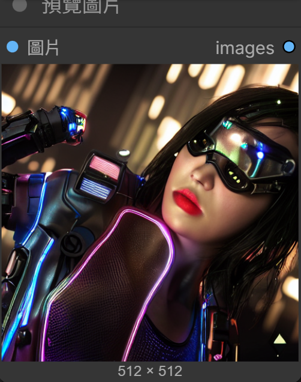
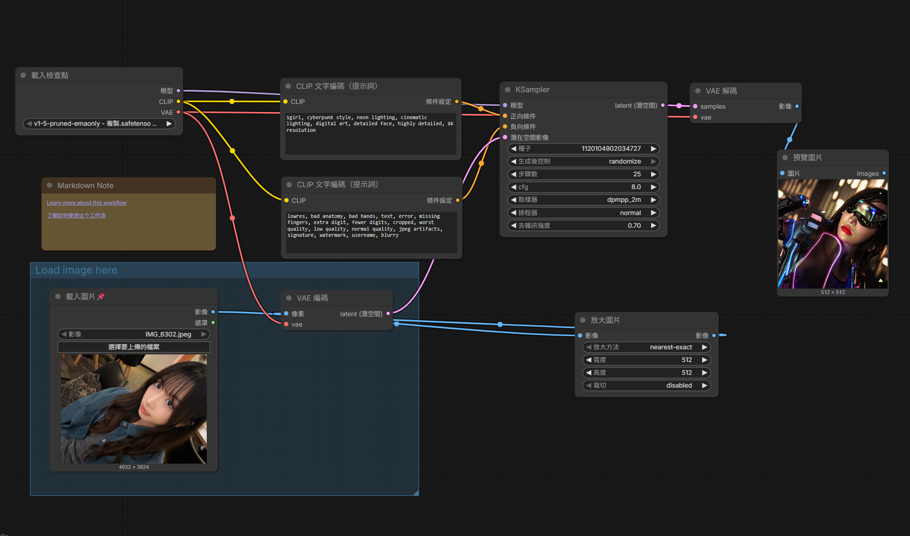

# comfy生成圖片

**原圖**

**AI 生成圖**

**完整工作流程圖**

**提示詞**

正向提示詞 : 

⁠1girl, cyberpunk style, neon lighting, cinematic lighting, digital art, detailed face, highly detailed, 8k resolution⁠

反向提示詞 : 

lowres, bad anatomy, bad hands, text, error, missing fingers, extra digit, fewer digits, cropped, worst quality, low quality, normal quality, jpeg artifacts, signature, watermark, username, blurry

**心得**

這次作業用了comfy生成圖,也是我第一次使用這個軟體,一開始遇到了很多挫折,產出兩三次圖片都是模糊的,後來修改了提示詞及一些數據等等,終於生出清晰的圖,萬分感動,過程中也有自己摸索一些,最後總算順利完成,學到了很多新的東西跟操作經驗!
